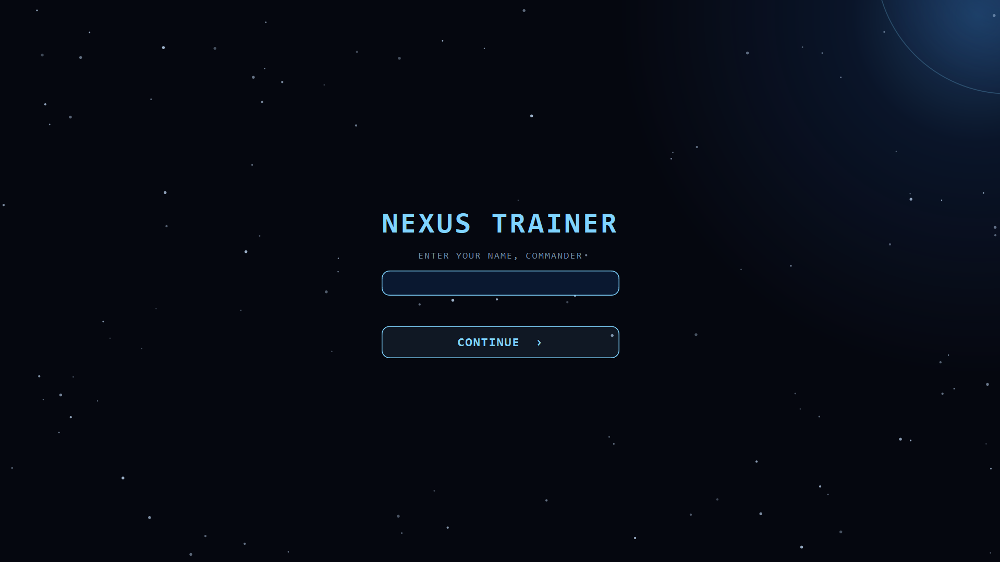
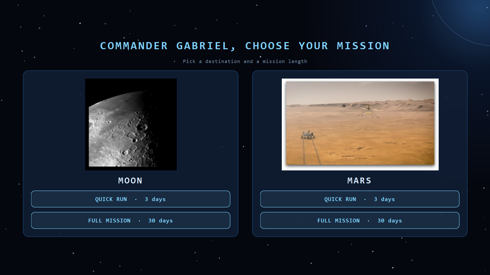
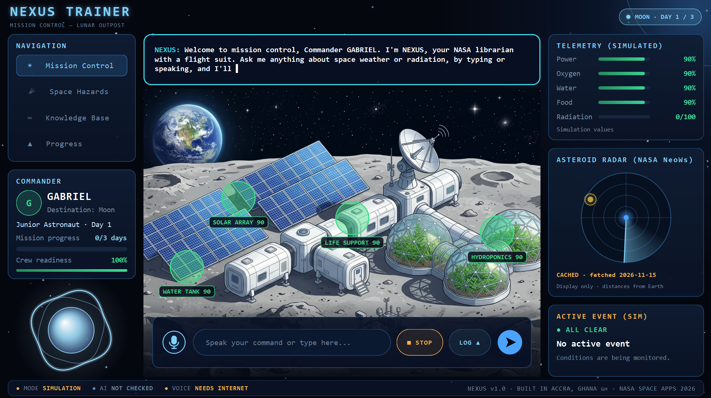
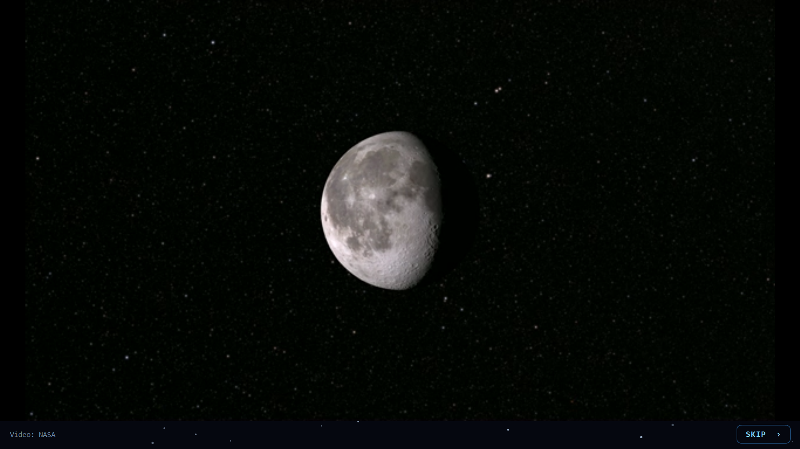
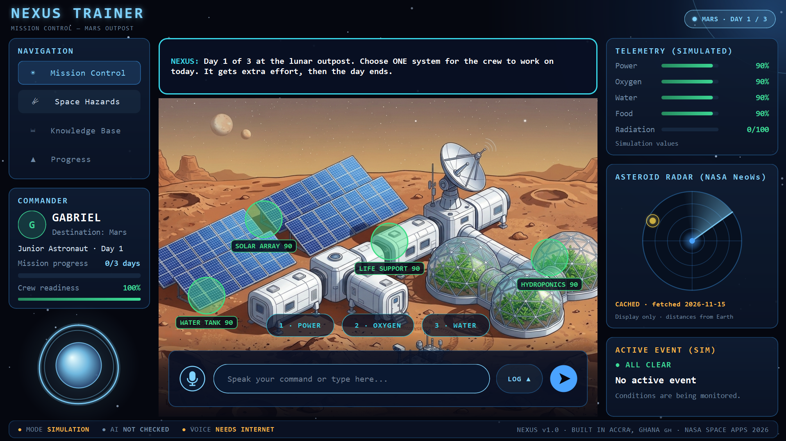
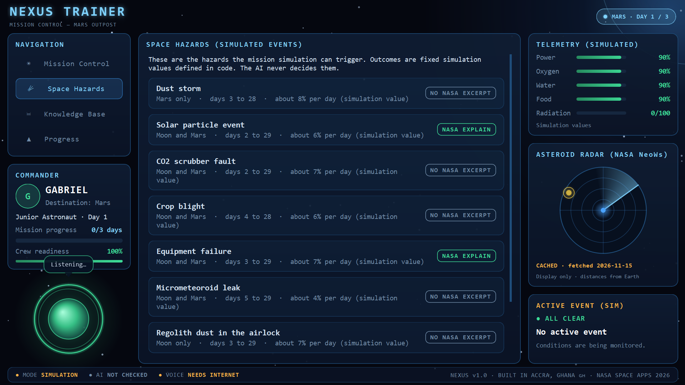

# NEXUS TRAINER

**A mission-control trainer for the next generation of astronauts.**
Built for the **NASA Space Apps Challenge 2026**: *"Build a Junior Astronaut Mission Trainer."*

You are the Commander of a Moon or Mars outpost. Balance power, oxygen, water, food and crew radiation, face space-weather emergencies, then learn from NASA's own documents with a Train Live LLM what you should have done.

🎥 **Demo video:** [Watch on YouTube](https://youtu.be/htp7CIZS3vw)

---

## 📸 Screenshots

| | |
|---|---|
| **Login** — enter your commander name to begin |  |
| **Destination select** — choose Moon or Mars, then Quick Run or Full Mission |  |
| **Mission Control** — the Moon outpost dashboard: telemetry, radar, feeds and the NEXUS bar |  |
| **Live simulation** — resource bars, solar-weather status and crew radiation in play |  |
| **Mars outpost** — the same mission-control loop on the Red Planet |  |
| **Space Hazards** — the built-in knowledge base NEXUS answers science questions from |  |

---

## ✨ What makes NEXUS different

> **Rules are code. NASA explains.**

| Layer | Who decides | How |
|---|---|---|
| **Simulation** | Deterministic Python | Fixed rules. Every outcome, event and number comes from code, never from an AI. |
| **Explanation** | RAG over NASA documents | After you choose, NEXUS retrieves a real passage from NASA and NOAA documents and **cites it**. If the documents don't contain the answer, it says: *"I don't have that in my NASA sources."* |
| **Copilot** | NEXUS, the glowing orb | Guides you by typed commands first. Voice input produces the same text and goes through the same handler. |

An AI never decides whether your choice was right, never invents events, and never changes a number.

---

## 🚀 The 3-day Quick Run (demo mode)

1. **Login:** enter your commander name.
2. **Choose** Moon or Mars, then **Quick Run (3 days)**.
3. **Day 1:** pick where the crew puts extra effort (power, oxygen, water or food). The simulation applies it once.
4. **Day 2: Solar particle event.** Three choices. Your choice changes the simulation. The top banner then flips from `NEXUS:` to `NASA:` and shows the retrieved NASA sentence, with its citation.
5. **Day 3: Crew radiation symptoms.** A second event, with the same flow.
6. **Result card:** your readiness score and your decisions.

The **Full Mission** runs 30 days with random events from a fixed table. Quick Run is the fixed 3-day demo.

---

## 🧠 How it works


- **Simulation:** `backend.py`, `events.py`, `state.py`, `config.py`.
- **RAG:** `knowledge.py` (retrieval, citations, offline fallback) and `evidence_bank.py` (the fixed question for each event and the NASA-aligned option).
- **Real data, display only:** `nasa_data.py` fetches NOAA SWPC proton flux, NASA NeoWs close approaches and NASA DONKI solar particle events. It caches them, so the app works offline. These values never affect the simulation.
- **Voice:** `voice.py` (microphone, speech), `wake.py` (wake word "nexus" / "hey nexus", Vosk), `tts_eleven.py` (optional ElevenLabs speech).
- **UI:** PyQt6 in `ui/`, with the floating orb in `orb.py`.

---

## 🎮 Commands

Type them in the bottom bar, or say them with the mic.

| Command | Does |
|---|---|
| `train on moon`  / `train on mars` | Start a Full Mission (30 days) |
| `quick run on moon`  / `quick run on mars` | Start the 3-day Quick Run |
| `boost power`  / `oxygen` / `water` / `food` | Extra crew effort for the day |
| `go`  | End the day |
| `status` , `ready`, `radiation`, `repeat`, `help` | Information |
| `show shelter`  | Order the shelter during a solar event |
| `1` , `2`, `3` | Pick an event option |
| `abort`  | End the mission |
| `what / why / how / explain …`  | Ask NEXUS a science question, answered only from the NASA documents, with sources |

All numbers are **simulation values**. Radiation figures are planning references and are **never medical clearance**.

---

---

## 🎙️ Meet NEXUS, your live mission copilot

NEXUS is a glowing orb that listens, talks back, and coaches you through the mission like a real-time NASA instructor.

- **Wake it like Siri.** Say **"Hey NEXUS"**, click the orb, or hold **Space** to talk.
- **Voice to voice.** You speak, NEXUS speaks back. Typed and spoken commands go through the same handler.
- **Run the mission hands-free.** After the start screen, you drive the mission by speaking or typing: *"boost oxygen"*, *"go"*, *"go to shelter"*. The simulation applies it. No manual clicking through menus.
- **Ask like you would ask a NASA coach.** *"Why should the crew shelter during a solar particle event?"* NEXUS answers from the NASA and NOAA documents and shows the **source and page**.
- **It explains your choices.** After every decision, the top banner flips from `NEXUS:` to `NASA:` with the retrieved passage.
- **It stays honest.** If the documents don't contain the answer, it says: *"I don't have that in my NASA sources."*

**Try saying:**
`"Hey NEXUS, quick run on Mars"` · `"boost oxygen"` · `"go"` · `"go to shelter"` · `"What is a geomagnetic storm?"`


---

## 📚 NASA documents used

The index was built from five public documents in `nasa_docs/` :

- NOAA *Space Weather 101* factsheet
- NASA HRP *Risk of Acute Radiation Syndromes due to Solar Particle Events* (2016)
- NASA *Extravehicular Activities Operations*, Chapter 5.4
- NASA *Space Flight Human-System Standard*
- NASA *Artemis Plan* (2020)

---

## 🛠️ Setup (Windows 10/11)

The voice features use `winsound`  and Windows speech, so Windows is required for audio. The simulation itself is plain Python.

```powershell
git clone https://github.com/DevTsamenyGabriel/nexus-astronaut-trainer.git
cd nexus-astronaut-trainer
python -m venv .venv
.\.venv\Scripts\activate
pip install -r requirements.txt
```

**1. Create a `.env` file** in the project root (all keys are optional, and the app has an offline fallback for each):

```env
GROQ_API_KEY=your_key            # AI wording for science answers (optional)
GROQ_MODEL=openai/gpt-oss-120b   # optional
ELEVENLABS_API_KEY=your_key      # optional voice
ELEVENLABS_VOICE_ID=your_voice_id
ELEVENLABS_SPEED=1.15            # optional
NASA_API_KEY=your_key            # optional, otherwise DEMO_KEY is used
NEXUS_MUTE=1                     # 1 = voice muted. Use 0 (or remove) to speak.
```

**2. NASA index.** The app needs the `chroma_db/` folder in the project root.
If it isn't in your clone, put the five PDFs in `nasa_docs/`  and rebuild it with `RAG_TEST/injest.py`.
<!-- Maintainer: confirm that injest.py writes chroma_db to the project root, or note the exact command here. -->

**3. Wake word (optional).** Download the small English Vosk model and place it at `models/vosk-model-small-en-us-0.15/`. Without it, the app still runs and wake-word listening is disabled.

**4. Run**

```powershell
python main.py
```

---

## 🔌 Offline by design

Every AI call has a fallback, and nothing is allowed to crash the demo.

| If this fails | NEXUS does this |
|---|---|
| No internet | Uses cached NOAA/NASA data and the local NASA index |
| Groq unavailable | Shows the retrieved NASA text with an "AI: OFFLINE" label |
| ElevenLabs unavailable | Falls back to the Windows voice |
| Nothing relevant in the documents | Replies *"I don't have that in my NASA sources."* |

Set `NEXUS_OFFLINE=1` to test offline mode.

---

## ✅ Tests and checks

| Script | What it checks |
|---|---|
| `python RAG_TEST/test_quick_flow.py`  | The Quick Run schedule (Day 2 and Day 3 events), the end of the mission, and that Full Mission stays at 30 days |
| `python RAG_TEST/probe_quick_science.py`  | What each NASA question retrieves, with distances and citations |
| `python RAG_TEST/test_tts_eleven.py`  | The voice layer offline, or with `--live` against ElevenLabs |

---

## 📁 Project structure

```
main.py             Entry point and Controller
backend.py          Deterministic simulation
events.py           Fixed events, options and effects
evidence_bank.py    Event → NASA question mapping
knowledge.py        RAG: retrieval, citations, fallback
nasa_data.py        Live NOAA/NASA data (display only)
voice.py, wake.py   Microphone, wake word, speech
tts_eleven.py       Optional ElevenLabs voice
orb.py              The floating NEXUS orb
state.py, config.py Shared state and mission length
ui/                 PyQt6 interface
RAG_TEST/           Ingestion and test scripts
```

---

## ⚠️ Honest limits

- This is an education tool. It is **not** real mission software, and its values are not real mission data.
- The NASA answers cover only the documents listed above. Questions outside them get the "not in my sources" reply.
- Quick Run uses the same two events for Moon and Mars.

---

## 👥 Team

Built in Accra, Ghana, for NASA Space Apps Challenge 2026.

- **Gabby** (AI engineer) — GitHub: [@DevTsamenyGabriel](https://github.com/DevTsamenyGabriel)
- **Portia OwusuahAgbeke** (teammate)

## 📄 License

MIT
